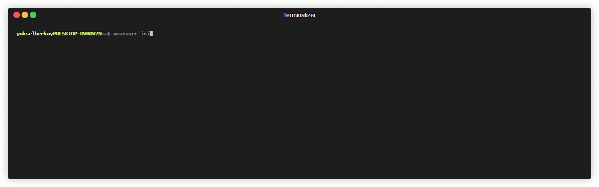

<h1 align="center">
Pmanager
</h1>
<div align="center">


</div>


## Demo


## Description
Store and retrieve your passwords from a secure offline database. Check if your passwords has leaked previously to prevent targeted password reuse attacks.

## Why develop another password manager ?
- This project was initially born from my desire to learn Rust.
- I was tired of using the clunky GUI of keepassxc.
- I wanted to learn more about cryptography.
- For fun. :)

## Features
- Secure password storage with state of the art cryptographic algorithms.
  -  Argon2id (64 MiB, 3 iterations, 4 lanes) with a random per-database salt for key derivation to make it harder for attacker to conduct brute force attacks.
  -  Aes-gcm256 with a fresh random nonce on every save for database encryption. The file header (format version, key derivation parameters, salt and nonce) is authenticated too.
  -  The decrypted database only ever lives in memory and is wiped after use, nothing is written to temporary files.
  -  Database and config files are only readable by your user, and are replaced atomically so a crash can not corrupt them.
  -  Passwords copied to the clipboard are excluded from clipboard history/cloud sync where the OS supports it, and are cleared after 10 seconds or on Ctrl-C.
- Custom encrypted key-value database which ensures data integrity.(Read the blog post I wrote about it [here](https://yukselberkay.github.io/programming/2022/09/12/post-keyval-db.html).)
- Easy to install and to use. Does not require connection to an external service for its core functionality.
- Check if your passwords are leaked before to avoid targeted password reuse attacks.
  - This works by hashing your password with keccak-512 and sending the first 10 digits to [XposedOrNot](https://xposedornot.com/api_doc).

## Installation
Pmanager depends on "pkg-config" and "libssl-dev" packages on **ubuntu**. Simply install them with
```bash
sudo apt install pkg-config libssl-dev -y
```

Download the binary file according to your current OS from [releases](https://github.com/yukselberkay/pmanager/releases), and add the binary location to PATH environment variable and you are good to go.


## Building from source
## Ubuntu & WSL
```bash
sudo apt update -y && sudo apt install curl 
curl --proto '=https' --tlsv1.2 -sSf https://sh.rustup.rs | sh
sudo apt install build-essential -y
sudo apt install pkg-config libssl-dev libxcb-render0-dev libxcb-shape0-dev libxcb-xfixes0-dev git -y
git clone https://github.com/yukselberkay/pmanager
cd pmanager
make install

```

## Windows
- Follow the instructions here to install Rust. -> https://www.rust-lang.org/tools/install
- Then install git for Windows. -> https://gitforwindows.org/
```powershell
git clone https://github.com/yukselberkay/pmanager
cd pmanager
cargo build --release
```

## Mac
```bash
git clone https://github.com/yukselberkay/pmanager
cd pmanager
cargo build --release
```

## Upgrading from 0.9.7 or older
Databases created by pmanager 0.9.7 and older use a fixed salt and a fixed encryption nonce, which seriously weakens their protection. Version 0.10.0 introduces a new database format and refuses to open old databases until they are migrated:
```bash
pmanager migrate
```
Your entries are converted to the new format, and you can optionally choose a new master password at the same time. The old file is kept next to the database as `db.pmanager.v1.bak`. Since it is still protected by the old scheme, delete it once you have checked that everything works. The migration also removes the temporary files that older versions could leave behind in your temp directory.

## Documentation
**Firstly the database needs to be initialized using "init" command.**
### Init
```bash
# Initializes the database in the home directory.
pmanager init --db-path ~
```
### Insert
```bash
# Insert a new user and password pair to the database. The password is copied to the clipboard afterwards.
pmanager insert --domain github.com
```

### Get
```bash
# Get a specific record by domain. This command will first copy username and then password to clipboard.
pmanager get --domain github.com
```
### Clip
```bash
# Copy only the password of a record to clipboard.
pmanager clip --domain github.com
```
### List
```bash
# List every record in the database.
pmanager list
```
### Update
```bash
# Update a record by domain. Press enter to keep the current username or password.
pmanager update --domain github.com
```
### Delete
```bash
# Deletes a record associated with domain from the database.
pmanager delete --domain github.com
```
### Leaked
```bash
# Check if a password in your database is leaked before.
pmanager leaked --domain github.com
```
### Migrate
```bash
# Upgrade a database created by pmanager 0.9.7 or older to the current format.
pmanager migrate
```

```
pmanager 0.10.0

USAGE:
    pmanager <SUBCOMMAND>

OPTIONS:
    -h, --help       Print help information
    -V, --version    Print version information

SUBCOMMANDS:
    clip      Copy password to clipboard by domain
    delete    Delete a key value pair from database
    get       Copy username and then password to clipboard by domain
    help      Print this message or the help of the given subcommand(s)
    init      Initialize pmanager
    insert    Insert a user password pair associated with a domain to database
    leaked    Check if a password associated with your domain is leaked
    list      Lists every record in the database
    migrate   Upgrade a database created by pmanager 0.9.7 or older to the current, more secure format
    update    Update a record from database
```
